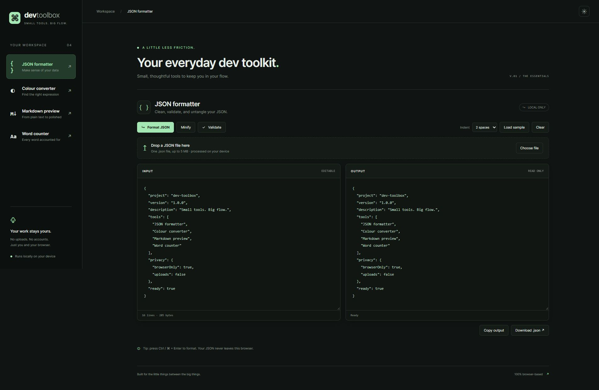
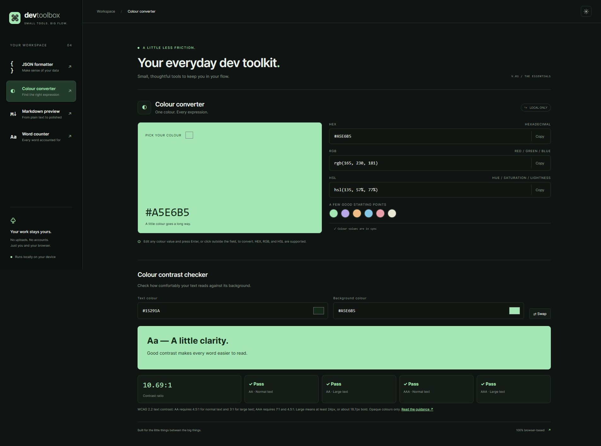

# Developer Toolbox

Five focused tools for the small tasks between the big tasks. Responsive, accessible, and private by design.

[Open the live toolbox](https://mrcozel.github.io/dev-toolbox/)

- **JSON formatter** — format, minify, validate, copy, and download JSON. Import a local `.json` file with the file picker or drag-and-drop (up to 5 MB). Failed imports preserve your current work. Two or four space indentation and Ctrl/Cmd + Enter.
- **Colour converter** — convert HEX, RGB, and HSL, use a colour picker, and copy values. Includes a live foreground/background contrast checker with WCAG 2.2 AA/AAA text-contrast results.
- **Markdown preview** — live preview with headings, lists, quotes, emphasis, links, and fenced code blocks. Raw HTML is escaped. This is a lightweight Markdown subset, not full GitHub Flavored Markdown.
- **Word counter** — words, Unicode characters, estimated sentences, paragraphs, and estimated reading time.
- **Note Pad** — a plain-text notepad with multiple auto-saving tabs. Add, rename, switch, and close notes; copy or download the current tab as `.txt` / `.md`. Closing or clearing a note requires confirmation. Existing single notes migrate into the first tab.
- Dark and light themes. Tool editor content stays in memory and clears on refresh; Note Pad tabs and the theme preference persist in this browser.

## Run locally

Requires Node.js 18 or newer. No dependency installation or build step.

```sh
node server.cjs
```

Open http://127.0.0.1:4173. Run all checks with `node --test`. If npm is installed, `npm start` and `npm test` work too.

## Structure

`docs/` is the complete deployable site. `core.js` contains pure conversion and rendering functions, `app.js` handles interactions, and `style.css` contains responsive themes. The first version uses plain JavaScript to remain small and dependency-free.

## Contribute

Open an issue describing the problem or feature, create a branch, and submit a focused pull request. Include a brief description and verification steps. Credit real collaborators with a `Co-authored-by` commit trailer when appropriate.

### Help build the next feature

- [Markdown tables](https://github.com/mrcozel/dev-toolbox/issues/4) — safe table rendering, inline formatting, and alignment.
- [Colour palette export](https://github.com/mrcozel/dev-toolbox/issues/5) — collect colours and export CSS or JSON.

Comment on an issue before starting so we can agree on the approach. Keep pull requests focused, add tests for changed behaviour, and include screenshots for visible UI changes.

## Screenshots

### JSON formatter and local file import



### Colour conversion and contrast checking



## GitHub Pages

The live site publishes from `main` → `/docs`. Merging a pull request that changes that folder automatically triggers a new Pages deployment. No build step is needed.

The contrast checker uses the [W3C relative luminance and contrast guidance](https://www.w3.org/WAI/WCAG22/Understanding/contrast-minimum). Pass/fail results use unrounded ratios; the displayed ratio is rounded to two decimal places. The tool evaluates opaque text colours, not overall page accessibility.

## Privacy

All tool processing happens in the browser. No analytics, external fonts, APIs, or third-party scripts are used. The hosting provider receives ordinary page requests. Clipboard access requires a secure context or localhost.

Note Pad tabs, names, content, and the selected tab use local storage on the current browser and site origin; they do not sync between devices. Avoid storing passwords or API keys. Clearing browser data removes notes. Export a backup when you need to keep a note. If saving fails (for example, storage is disabled or full), the draft remains in memory and the app shows a warning; download it before leaving. Notes changed in another tab trigger a notice instead of replacing your current draft.

## License

MIT — see LICENSE.


